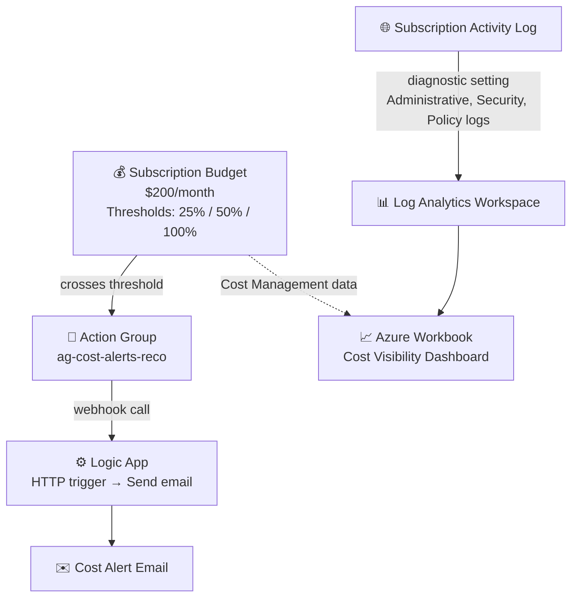

# ☁️ Project 1: Azure Cost Visibility Dashboard


A hands-on project where I built a **cost tracking and alerting system** that turns confusing Azure billing line items into plain-language visibility, with automatic email alerts before spend becomes a surprise.

---

## 📌 Overview

Most small businesses move to the cloud expecting it to be cheaper, then the bill arrives full of line items like `Microsoft.Compute/virtualMachines - $340` that nobody can interpret, predict, or explain. This project replaces that opacity with a system that watches spend continuously, escalates automatically at defined thresholds, and presents everything in a dashboard a non-technical business owner can actually read.

**The interview framing that matters here:** lead with the business outcome: *"I built a system that gives business owners real-time visibility into Azure spend and alerts them before the bill becomes a problem"*. The specific services used are supporting detail, not the headline.

| Detail | Value |
|---|---|
| **Difficulty** | Beginner |
| **Time to complete** | 3–4 hours |
| **Cloud Provider** | Microsoft Azure |
| **Core Services** | Cost Management (Budgets), Monitor (Action Groups), Log Analytics, Logic Apps, Azure Workbooks |
| **Core Concept** | Proactive cost governance and plain-language reporting |
| **Terraform Provider** | `hashicorp/azurerm ~> 5.0` |

---

## 🏗️ Architecture



**How it works:** A subscription-level budget watches total spend and fires at three thresholds (25%/$50, 50%/$100, 100%/$200). Each threshold calls an Action Group, which invokes a Logic App via webhook; the Logic App formats the alert and sends a plain-language email. Independently, the subscription's activity log streams into Log Analytics, and an Azure Workbook pulls both the activity data and Cost Management data into one dashboard view.

---

## ✅ Prerequisites

- **Mac:** Homebrew → Terraform + Azure CLI
- **Windows:** Terraform + Azure CLI installers, added to `PATH`
- `az login` and the correct subscription selected

---

## 🏷️ Key Variables

| Variable | Example | Purpose |
|---|---|---|
| `yourname` | `reco` | Keeps resource names unique |
| `location` | `East US` | Deployment region |
| `alert_email` | *(your email)* | Destination for budget threshold alerts |

---

## 🚀 What Gets Built

```
rg-cost-dashboard-reco
├── Log Analytics Workspace       (law-cost-reco)
├── Monitor Action Group          (ag-cost-alerts-reco)
├── Consumption Budget            ($200/mo, alerts at 25% / 50% / 100%)
├── Logic App Workflow            (la-cost-alert-reco - HTTP trigger, configured post-deploy)
└── Diagnostic Setting            (subscription activity log → Log Analytics)
```

### Key Design Decisions

| Setting | Value | Why |
|---|---|---|
| `retention_in_days` | `30` | Minimum allowed; keeps Log Analytics cost negligible for a lab |
| `time_grain` | `Monthly` | Matches Azure's actual billing cycle |
| Budget thresholds | 25% / 50% / 100% | Early warning, mid-point check, hard ceiling, not just one alert at the end |
| `use_common_alert_schema` | `true` | Standardized email format across all alert types |
| Diagnostic log categories | `Administrative`, `Security`, `Policy` | Captures *who changed what*, not just spend; useful for correlating a cost spike with an actual change |

---

## 🛠️ Deployment Steps

### 1. Folder Setup
```bash
mkdir ~/cost-dashboard-001 && cd ~/cost-dashboard-001
touch main.tf variables.tf outputs.tf terraform.tfvars
```

### 2. Configure Variables
`terraform.tfvars`:
```hcl
yourname    = "reco"
location    = "East US"
alert_email = "your.email@example.com"
```

### 3. Deploy
```bash
terraform init
terraform plan
terraform apply
```
Expect **6 resources** to be created in roughly 2–3 minutes.

> ⚠️ **Provider version note:** If you're on `azurerm` provider **v5.0**, this deployment will likely fail on first apply with `MissingSubscriptionRegistration` errors for `Microsoft.OperationalInsights`, `microsoft.insights`, and `Microsoft.Logic`; v5.0 stopped auto-registering resource providers by default. See [Troubleshooting](#-troubleshooting) below for the fix before you run `apply`.

### 4. Configure the Logic App Workflow (Portal)
Terraform provisions the Logic App container; the trigger/action logic is built in the visual designer; this is intentional, since workflow logic is easier to test visually than in HCL.

```
la-cost-alert-reco → Logic app designer
  Trigger: When a HTTP request is received
    → copy the HTTP POST URL (this is the webhook Azure Monitor will call)
  + New step: Office 365 Outlook → Send an email (V2)
    To: your alert email
    Subject: Azure Cost Alert - Budget Threshold Reached
    Body: dynamic content → Body (from the HTTP trigger)
```

### 5. Wire the Logic App into the Action Group
```bash
az monitor action-group update \
  --name ag-cost-alerts-reco \
  --resource-group rg-cost-dashboard-reco \
  --add-action logicapp la-webhook la-cost-alert-reco \
    /subscriptions/<sub-id>/resourceGroups/rg-cost-dashboard-reco/providers/Microsoft.Logic/workflows/la-cost-alert-reco \
    <logic-app-callback-url>
```
Get `<sub-id>` via `az account show --query id -o tsv`, and `<logic-app-callback-url>` from the designer.

### 6. Build the Cost Dashboard (Azure Workbooks)
```
Monitor → Workbooks → + New
  + Add → Add query
    Data source: Azure Resource Graph
    Query:
      resourcecontainers
      | where type == "microsoft.resources/subscriptions/resourcegroups"
      | project resourceGroup, location
  + Add → Add metric → Cost Management (for your subscription)
  Save as: "Cost Visibility Dashboard"
```

---

## ✅ Verification Checklist

- [ ] Resource group `rg-cost-dashboard-reco` exists
- [ ] Budget `budget-cost-reco` appears in Cost Management → Budgets
- [ ] Action group `ag-cost-alerts-reco` exists in Monitor → Action groups
- [ ] Logic App shows **Enabled** with an HTTP trigger + Send email action
- [ ] Log Analytics workspace `law-cost-reco` exists
- [ ] Workbook is saved and visible under Monitor → Workbooks

---

## 🐛 Troubleshooting

| Issue | Cause | Fix |
|---|---|---|
| `BudgetStartDateInvalid` | Start date isn't the first of the current/future month | Update `start_date` in `main.tf` to the 1st of the current month |
| `AuthorizationFailed` on budget | Account lacks Cost Management permissions | `az role assignment create --role "Cost Management Contributor" --assignee <your-email> --scope /subscriptions/<sub-id>` |
| Logic App email step asks for sign-in | Office 365 connector requires interactive auth | Sign in through the portal designer; Terraform can't automate this step |
| Alert email not received | No spend has actually crossed a threshold yet | Manually trigger a test action from the Action Group in the portal to verify email delivery |
| `MissingSubscriptionRegistration: Microsoft.OperationalInsights` / `microsoft.insights` / `Microsoft.Logic` | Provider **v5.0** no longer auto-registers Azure resource providers by default | Either add `resource_provider_registrations = "legacy"` to the `provider "azurerm" {}` block, or manually run `az provider register --namespace <name>` for each and wait for `Registered` status before re-applying |

---

## 🧹 Teardown
```bash
terraform destroy
```
Deletes the resource group, budget, Logic App, and Log Analytics workspace.

---

## 🔐 Security Notes

- **Least privilege on cost data.** The `Cost Management Contributor` role needed to manage budgets is scoped narrowly to cost operations; it doesn't grant the ability to modify the resources being billed, which matters if this budget owner shouldn't also have infrastructure change rights.
- **Activity log capture is a security control, not just a cost one.** Streaming `Administrative`, `Security`, and `Policy` categories into Log Analytics means an unexpected cost spike can be directly correlated with *who changed what and when*, turning "why did the bill jump?" from a guessing game into a query.
- **Interactive auth for the Office 365 connector is a deliberate limitation, not a gap.** Terraform intentionally can't automate that sign-in step; it forces a real human identity behind the email-sending action rather than a stored credential, which is the safer default for anything touching a mail-sending connector.
- **Multiple thresholds, not one.** Alerting only at 100% means the first warning *is* the overage. Catching it at 25% and 50% turns a reactive scramble into an early, correctable trend.

---

## 📚 What I Learned

- Configuring Azure Cost Management budgets with multi-threshold alerting
- Connecting Azure Monitor Action Groups to a Logic App via webhook for custom-formatted notifications
- Building an Azure Workbook combining Resource Graph queries and Cost Management data
- Streaming subscription-level activity logs into Log Analytics for auditability
- Diagnosing and resolving `MissingSubscriptionRegistration` errors introduced by Terraform's `azurerm` provider v5.0 default behavior change
- Why cost governance and security auditing overlap more than they first appear to

---

**Author:** Reco
